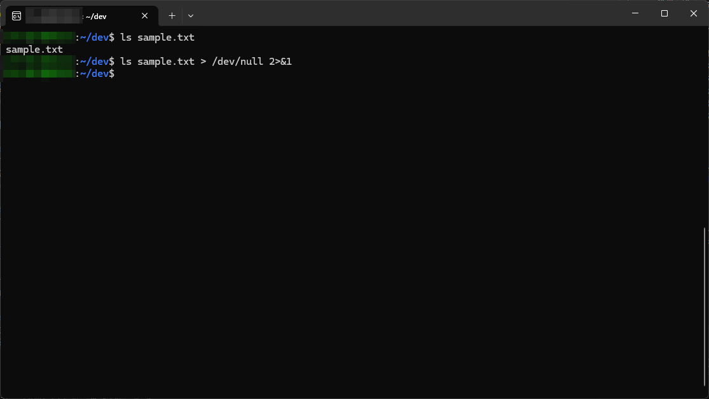

AIをぶん回していて、`command > /dev/null 2>&1`みたいなコマンド実行を求められることが増えました。 
何も出力しないみたいな認識はありましたが、2とか1って何ぞ？ってことで調べてみました。 

## そもそもの動き
`command > /dev/null 2>&1`がそもそもどんな動きをするかについて紹介します。 
とはいっても大まかな動きは普通のリダイレクトと同じでコマンドの実行結果を/dev/nullに書き込むみたいな流れです。 

動きとしてはコマンド実行したときに、コンソールに何も表示されなくなります。 
試しにlsで実行してみると画像の感じになります。 

## /dev/nullについて
で、この/dev/nullは何かというと、ヌルデバイスというUnix系OSにある特殊ファイルです。 
ここに対して書き込むと、書き込みバイト数のみを返すだけで書き込んだデータはどこにも保存されず破棄されます。 

## 2>&1について
では`2>&1`が何かについてですが、数字については以下になります。 

- 1: 標準出力
- 2: 標準エラー出力

で、`&`はファイルディスクリプタ番号を示すものになるので、結果としては標準エラー出力も標準出力にまとめてねって意味みたいです。 

## まとめ
コマンド実行時の出力は標準出力と標準エラー出力があり、通常のリダイレクトに加え標準エラー出力も/dev/nullに向けることでコンソール上に何も出なくなる動きになります。 
エラーも含めて全部捨ててしまうので、何を捨てているのかを意識しておくと安心ですね。 
