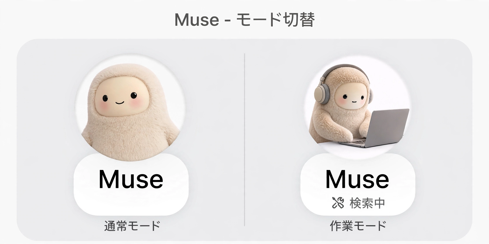
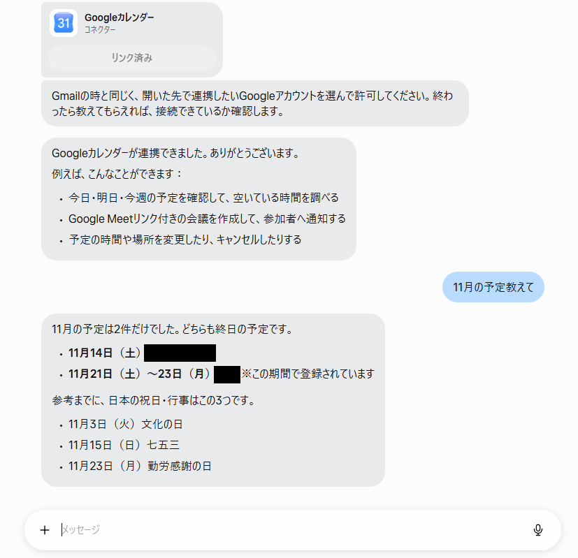
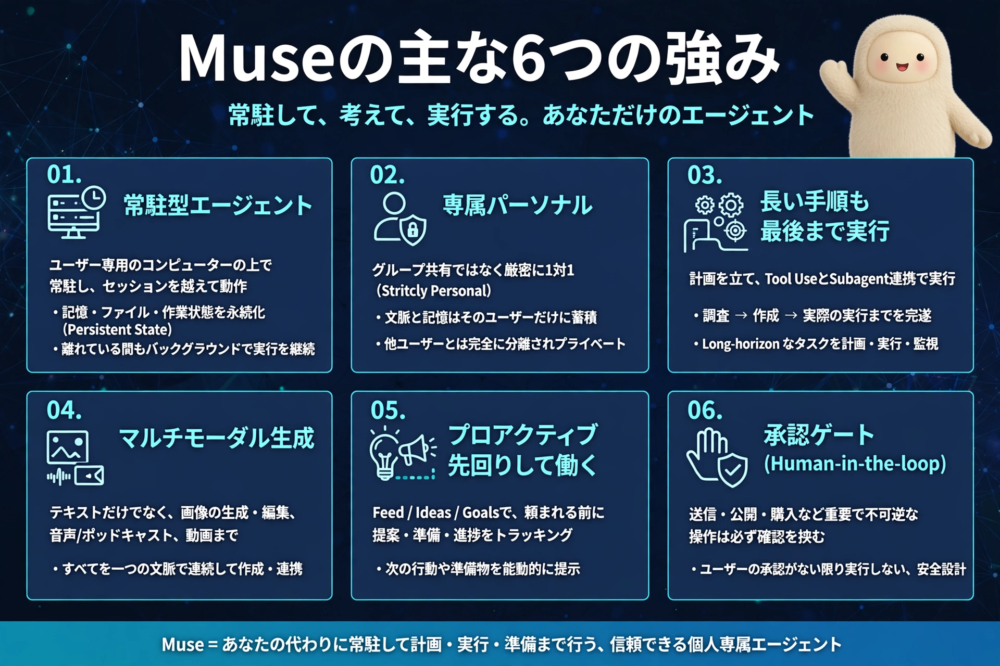
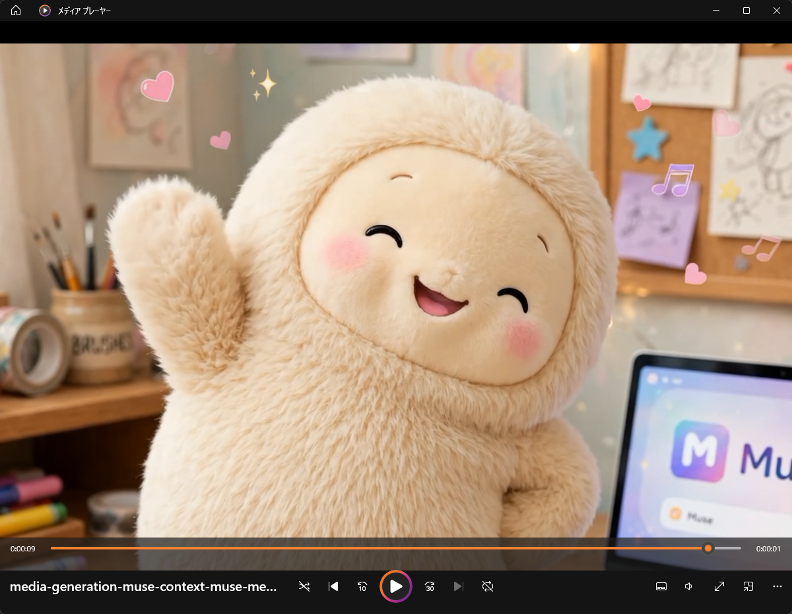

Museがすごいと話題になっていたので実際に触ってみました。 

## Museとは
Museとは、Meta社が公開したパーソナルAIエージェントです。 
日本では、2026年10月23日に公開されました。 

## 触りやすい
Meta社の戦略かもしれませんが、UIが分かりやすかったり、性格に関するプロンプトを埋め込んでいないのになんか人懐っこさがありました。 
チャットに対して👍リアクションしてくれたり、実行中にパソコン触ってるアイコンに変わったりするので、ちょっと愛らしさもあるんですよね～。 

パーソナルAIエージェントなので、既存ツールとの連携もできます。 
接続もかなり簡単でボタン押下でアカウント選択するだけでした。 

## 強み
画像作ってもらいましたが、常駐型による長期記憶と、汎用性の高さ、使用量を気にせず使える使いやすさだと思います。 
特に、使用量の箇所については顕著で、画像作ったりする程度では週間制限に引っかかる気配がないので、プロンプトの練習としても結構使えると思います。 

## まとめ
全体的に使いやすい印象でした。 
まだ使い切れていない機能もありますが、パーソナルAIエージェントが今後どうなっていくのかを見る意味でも、しばらく触り続けてみたいと思います。 

https://about.fb.com/ja/news/2026/10/muse-personal-ai-agent-launches-in-japan/ 

余談ですが、なんかNICOBOみたいな可愛さがありますね！ 

